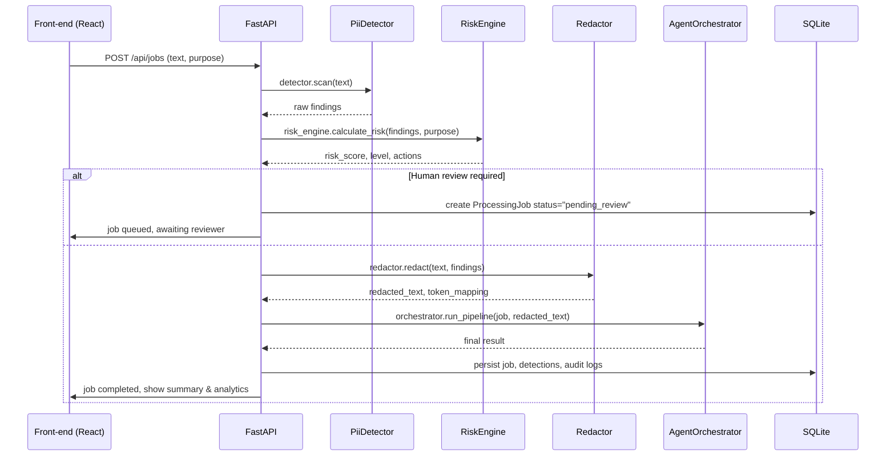

# Architecture Details

This document expands on the high‑level diagram shown in the root README and explains the request‑to‑response flow for a typical privacy‑scan job.

## Components

| Component | Responsibility |
|-----------|-------------------|
| **React Front‑end** | Provides the UI – dashboard, document upload, job list, analytics, and settings. Communicates with the backend via the REST API.
| **FastAPI (app.main)** | Entrypoint for all HTTP routes (`/api/*`). Handles authentication stubs, request validation, and forwards work to service layer objects.
| **PII Detector (`app.privacy.scanner`)** | Rule‑based regex & heuristic detection. Returns a list of raw findings with offsets, confidence, and severity. optional Presidio integration is disabled by default.
| **Risk Engine (`app.privacy.risk_engine`)** | Calculates a numeric risk score and risk level based on configured business rules, the set of detections and the declared `processing_purpose`.
| **Redactor (`app.privacy.redactor`)** | Takes the original text and the resolved finding list, replaces each PII entity with a token placeholder (`[EMAIL_1]`, `[PHONE_1]`, …) or a masked preview. Guarantees that offsets remain consistent after redaction.
| **Agent Orchestrator (`app.agent.orchestrator`)** | Bounded autonomous agent that decides which tools to run (e.g., summarisation, classification) based on risk level and user‑defined policies. It also enforces prompt‑injection detection and human‑review gating.
| **Ollama (optional)** | When a local LLM is available, the orchestrator can call Ollama to generate summaries or classifications. If Ollama is not reachable, deterministic fallbacks are used.
| **SQLite DB (`backend/app/db/session.py`)** | Stores `ProcessingJob`, `PiiDetection`, `AgentRun`, `AuditLog`, `PrivacySetting`, and benchmark evaluation records. All tables are defined in `models/entities.py`.
| **Retention Service (`app.services.retention_service`)** | Periodic cleanup job that deletes jobs older than the configured retention period, while preserving audit logs that are required for compliance.
| **Demo Service (`app.services.demo_service`)** | Generates synthetic documents for UI demos and benchmarks.

## Request Lifecycle (Privacy Scan)

## Data Hygiene & Privacy Guarantees
- **Raw sensitive content** is never persisted. Only the redacted output, detection metadata, and a non‑sensitive preview are stored in the DB.
- **AuditLog** records only non‑PII metadata (action, timestamps, and optional hashed identifiers).
- **Retention** automatically removes `ProcessingJob` rows older than the configured `RETENTION_DAYS` (default 365) while keeping minimal audit entries.

---

## Extending the Architecture
- To enable Microsoft Presidio, set `self.has_presidio = True` in `app/privacy/scanner.py` and ensure the required spaCy model is installed.
- To add a new LLM backend, implement a service in `app/llm/` that conforms to the `LLMProvider` interface and inject it into the orchestrator.
- For production deployments, replace SQLite with PostgreSQL by adjusting `DATABASE_URL` in `.env` and updating the Alembic migration scripts (not included in this prototype).
